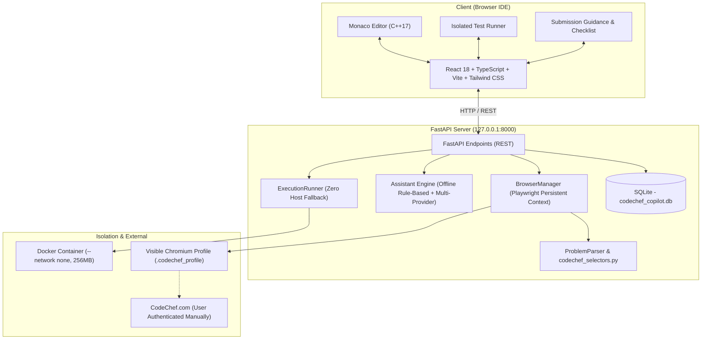

# CodeChef Copilot Architecture

## System Overview

CodeChef Copilot is structured as a local-first application designed to respect educational integrity, data privacy, and security boundaries.

## Core Subsystems

### 1. Browser Manager (`app/services/browser/manager.py`)
- Uses Playwright for Python with a persistent browser context in `./.codechef_profile`.
- Chromium window is visible to the user.
- **Manual Authentication**: The user logs in manually; no passwords, cookies, or session tokens are read, intercepted, or saved.
- **Challenge Detection**: Detects CAPTCHA, Cloudflare Turnstile, and security verification challenges, halting automated capture and prompting the user to resolve them in the browser.
- **On-Demand Capture**: Only inspects the active DOM when the user clicks **Capture**. Never polls pages in the background.

### 2. Resilient Problem Parser (`app/services/parser/problem_parser.py` & `codechef_selectors.py`)
- Decouples selectors into `codechef_selectors.py`.
- Extracts title, problem statement, input format, output format, constraints, and sample test cases.
- Computes a parser confidence score (0.0 to 1.0).
- Provides a manual edit & paste fallback modal if layouts change or content is incomplete.

### 3. Academic Integrity & Assistant Engine (`app/services/assistant/`)
- **Default Learning Mode**: Provides conceptual explanations, 3-tier graduated hints, complexity analyses, and constructive code reviews. Full solution generation is strictly blocked.
- **Practice Mode**: Gated behind an explicit user confirmation checkbox verifying that AI-assisted solutions are permitted under the specific course/contest rules.
- **Offline Rule-Based Fallback**: Works completely offline without requiring an external AI API key. Supports optional Gemini and OpenAI providers configured via backend environment variables.

### 4. Isolated Execution Engine (`app/services/execution/runner.py`)
- Executes C++17 inside an isolated container with hard ceilings:
  - `--network none` (network access disabled)
  - `--memory 256m` (256MB memory cap)
  - `--cpus 1.0` (1 CPU core limit)
  - `--pids-limit 64` (process limit)
  - Wall-clock timeout (default 5.0s)
- **Fails Closed**: If the Docker daemon is unreachable, execution halts with a clear `docker_unavailable` diagnostic message. Host execution fallback is strictly prohibited.
- Temporary directories are deleted immediately following execution.

### 5. Local Persistence (`app/models/` & SQLite)
- All metadata (problems, drafts, execution runs, assistant interactions, settings) are stored locally in `codechef_copilot.db`.
- No sensitive user credentials or tokens are ever persisted.
