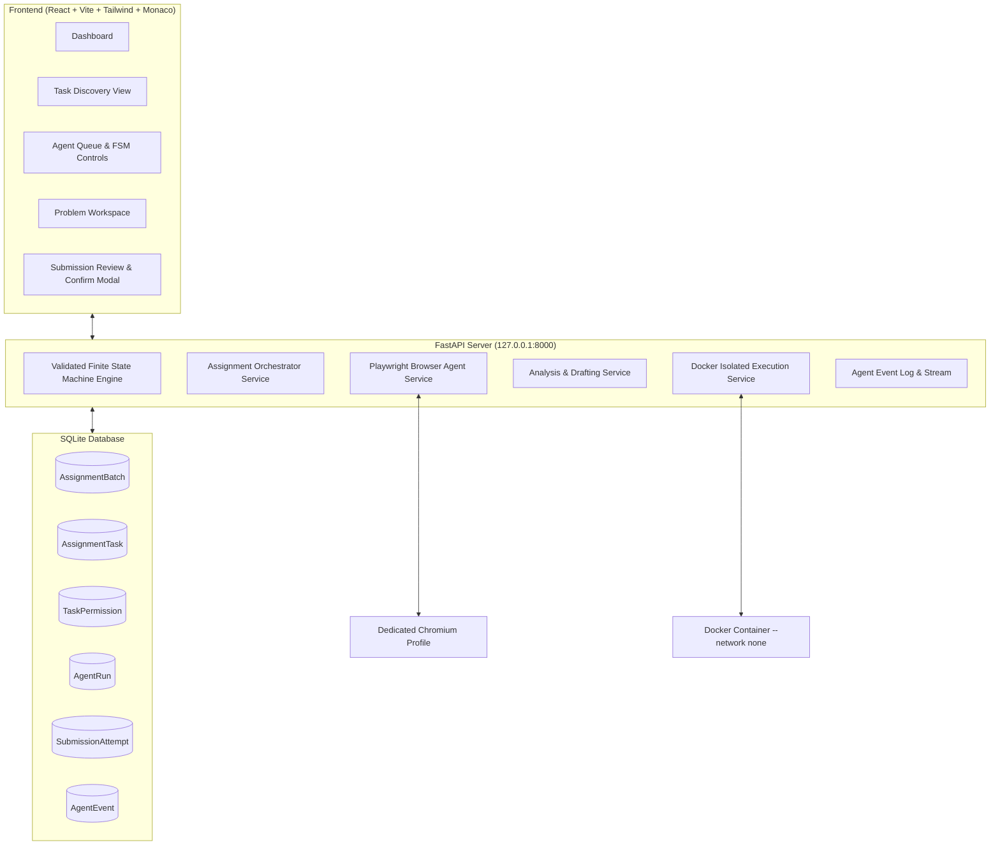

# CodeChef Copilot → Autonomous Coding Agent Upgrade Plan

## 1. Upgrade Objectives
Upgrade the existing local-first CodeChef Copilot into a supervised, browser-assisted coding agent for CodeChef practice tasks and authorized assignments, preserving all academic integrity rules and architecture foundations.

## 2. Integrity & Security Boundaries
- **Default Unknown / Learning Mode**: All newly discovered and added tasks default to `assistance_status="unknown"` and `task_mode="learning"`. Full solution generation is disabled.
- **Explicit Task Permission Required**: Complete solution generation requires per-task confirmation that AI assistance is permitted (`ai_assistance_allowed` & `task_mode="authorized_practice"`).
- **Two-Step Submission Gating**: Automated submission defaults to `False`. When enabled, it requires a fresh, short-lived, single-use confirmation token (`/submission/prepare` -> `/submission/confirm`). Token is cryptographically tied to code hash, task ID, and destination URL; changes invalidate it.
- **Visible Verdict Recording Only**: Records only visible judge verdicts or `PENDING`. No scraping private endpoints or fabricating results.
- **No Safeguards Bypass**: Never bypass CAPTCHA, Cloudflare, MFA, or rate limits. Pauses for human interaction on security markers.

## 3. Architecture & Subsystem Extensions

## 4. Phase-by-Phase Implementation Steps

### Phase 1: Database Models & FSM Engine
- Extend SQLAlchemy models: `AssignmentBatch`, `AssignmentTask`, `TaskPermission`, `AgentRun`, `SubmissionAttempt`, `AgentEvent`.
- Implement validated finite-state machine transitions:
  `DISCOVERED` -> `NEEDS_PERMISSION_CONFIRMATION` -> `QUEUED` -> `OPENING_PROBLEM` -> `PARSING_PROBLEM` -> `NEEDS_PROBLEM_REVIEW` -> `ANALYZING` -> `DRAFTING` -> `COMPILING` -> `TESTING` -> `DEBUGGING` -> `READY_FOR_REVIEW` -> `NEEDS_SUBMISSION_PERMISSION` -> `NEEDS_SUBMISSION_CONFIRMATION` -> `SUBMITTING` -> `VERIFYING_VERDICT` -> `COMPLETED` / `FAILED` / `PAUSED` / `CANCELLED`.
- Implement single-use submission token store with TTL (5 mins) and code hash validation.

### Phase 2: Browser Agent Extensions & Task Discovery
- Extend `codechef_selectors.py` for practice lists, contest problem tables, and assignment rows.
- Implement `BrowserManager.discover_visible_tasks(source_url)`.
- Extract title, URL, visible status, course/assignment group, parser confidence.
- Extend `BrowserManager.automate_submission()` with visible editor filling, submit button identification, and visible verdict scraping (with human intervention fallback).

### Phase 3: Agent Orchestrator & Autonomous Pipeline
- Implement `AssignmentOrchestrator`:
  - Batch creation from discovery.
  - Task selection into queue.
  - Permission updates (`assistance_status`, `automated_submission_allowed`, `task_mode`).
  - Pipeline execution loop: analyze -> draft -> compile -> test -> bounded debug (max 3) -> review.
  - Queue controls: start, pause, resume, cancel, emergency stop.
  - Background resilience: persist state after each step, safe resume on restart.
  - Audit event emission (`AgentEvent`).

### Phase 4: API Endpoints (Section 13)
- `/api/agent/discover`
- `/api/agent/batches`, `/api/agent/batches/{batch_id}`
- `/api/agent/batches/{batch_id}/tasks/select`
- `/api/agent/tasks/{task_id}/permission`
- `/api/agent/tasks/{task_id}/start`, `/pause`, `/resume`, `/cancel`
- `/api/agent/tasks/{task_id}`
- `/api/agent/tasks/{task_id}/events`
- `/api/agent/tasks/{task_id}/analyze`, `/draft`, `/compile`, `/test`, `/review`
- `/api/agent/tasks/{task_id}/submission/prepare`
- `/api/agent/tasks/{task_id}/submission/confirm`
- `/api/agent/tasks/{task_id}/submission/status`
- `/api/agent/queue/status`, `/api/agent/queue/pause`, `/api/agent/queue/resume`, `/api/agent/queue/clear`

### Phase 5: Frontend UI Upgrade
- Add navigation for **Discovery** and **Agent Queue**.
- **Discovery View**: Scan visible page, task table with checkboxes, permission labels, add to queue.
- **Agent Queue View**: FSM visual progress, task cards, live controls (Start/Pause/Resume/Cancel/Emergency Stop), audit event log.
- **Task Workspace**: Enhanced with current agent phase, draft versions, debug repair history.
- **Submission Review Modal**: Destination URL, code hash, test summary, one-time confirmation, manual submission fallback.

### Phase 6: Automated Testing & Verification
- Unit & integration tests for FSM transitions, permission gates, token invalidation on code change, duplicate submission prevention, browser challenge pauses, parser fixtures.
- Frontend build & typecheck verification.
- Documentation & README update.
